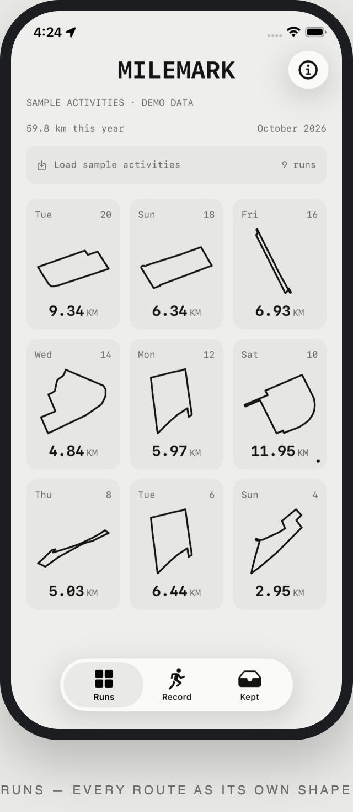
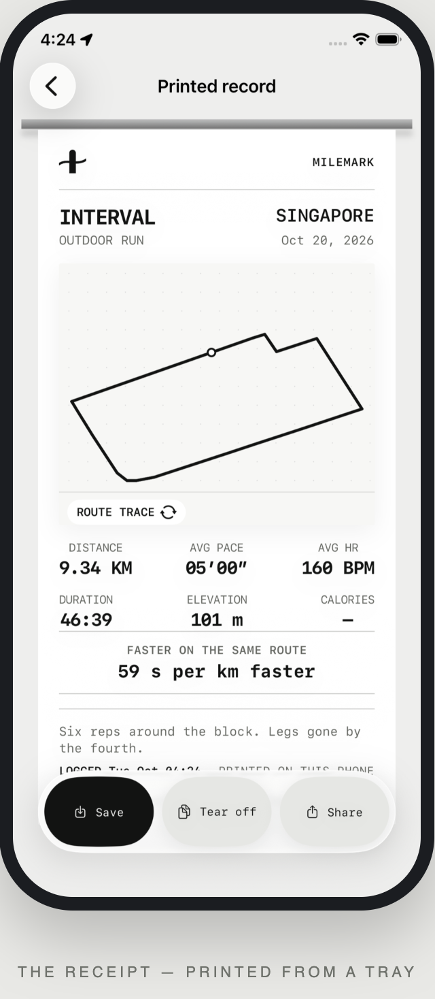
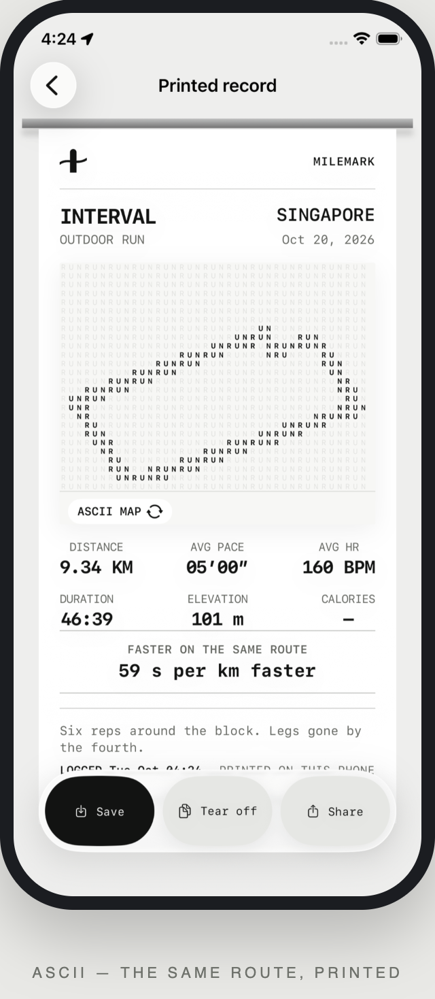
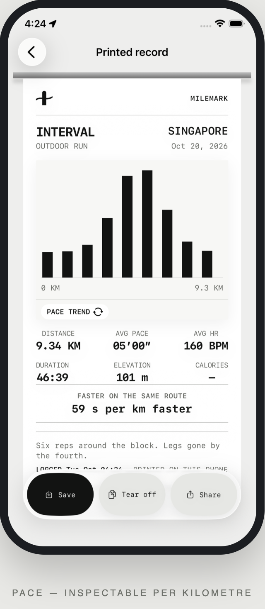
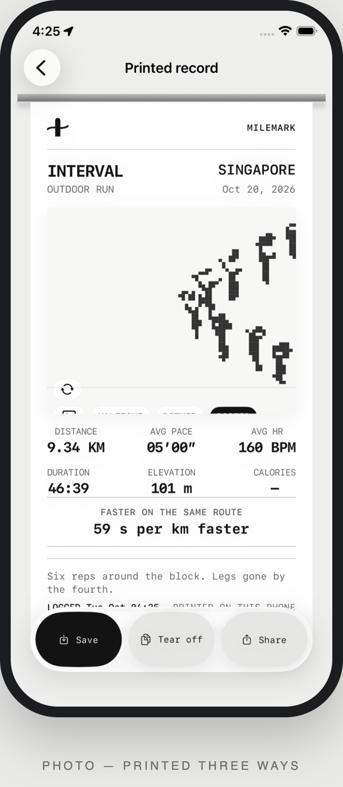
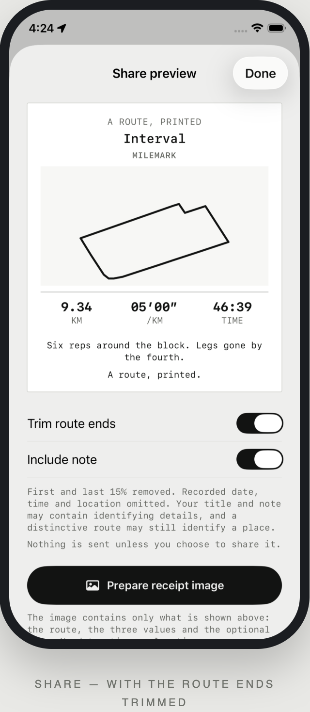
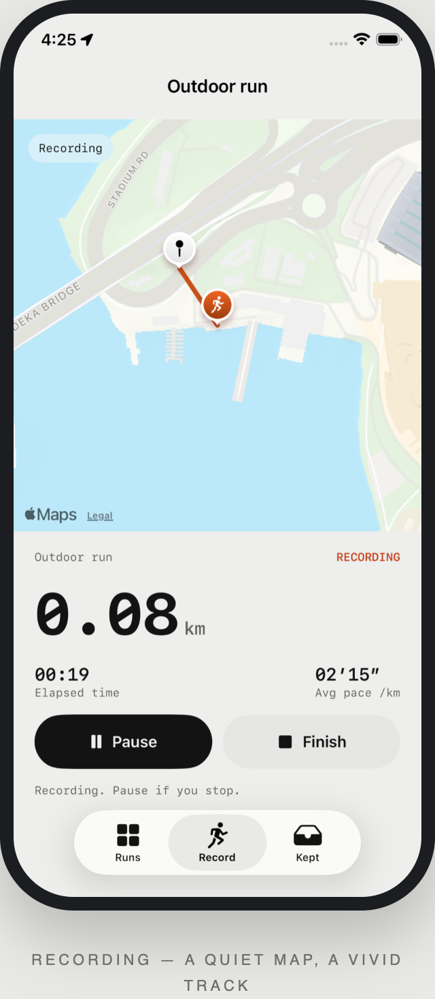
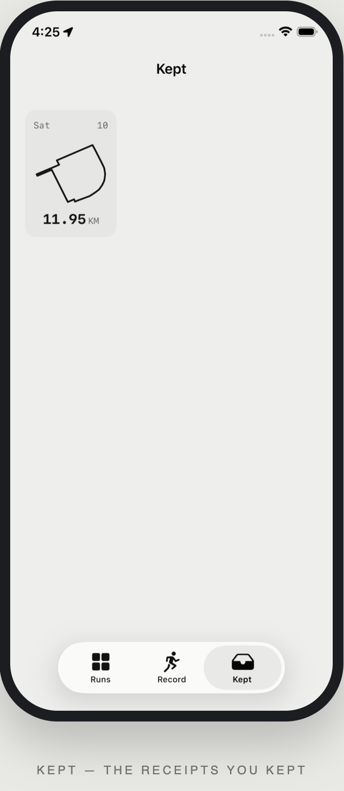
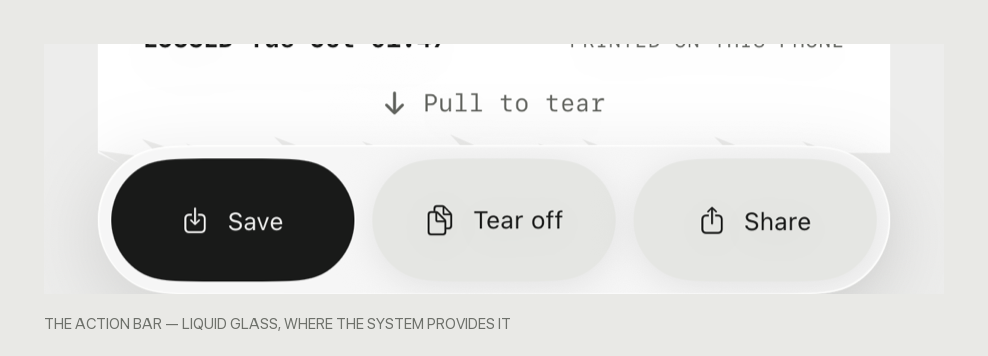
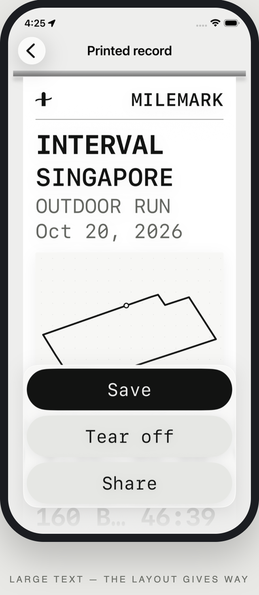

# Milemark

A running app for iPhone that turns every route into a printed receipt.

Milemark records a run on a real map, then prints it: a thermal-paper receipt
with your route drawn on it, your distance, pace and time, and an optional note.
Runs are kept in an archive of route silhouettes rather than a dashboard of
numbers, and finished receipts can be collected into a collection or shared
with the ends of the route trimmed.

## Screens

<table>
<tr>
<td width="33%" valign="top">

</td>
<td width="33%" valign="top">

</td>
<td width="33%" valign="top">

</td>
</tr>
<tr>
<td width="33%" valign="top">

</td>
<td width="33%" valign="top">

</td>
<td width="33%" valign="top">

</td>
</tr>
<tr>
<td width="33%" valign="top">

</td>
<td width="33%" valign="top">

</td>
<td width="33%" valign="top"></td>
</tr>
</table>

These are the real app running in the simulator. The captures come from
[`design/capture-screenshots.sh`](design/capture-screenshots.sh) and the frames
from [`design/render-frames.mjs`](design/render-frames.mjs); the capture fails
if the recording did not record anything, so a blank map cannot slip in. The
images are pinned to one width so they line up.

## Status

**Early development.** The core loop — record a run, review it, print the
receipt, keep it, share it — is implemented and runs on a simulator. Several
surfaces are still provisional.

| Area | State |
|---|---|
| Route recording with Core Location | Working, including pause/resume, auto-pause and background location |
| Live map | Working, with a quiet muted basemap and a vivid track |
| Route archive | Working |
| Printed receipt with four graphic treatments | Working |
| Review and share preview | Working |
| Sharing | Exports a receipt image to the system share sheet |
| Photo print treatment | Working, in three ways: halftone, dither and poster |
| Collection of kept receipts | Working |
| Comparison with the last run on the same route | Working, by pace |
| Haptics | Working |
| Liquid Glass action bar | On iOS 26 and later; a matched flat bar elsewhere |
| Dynamic Type | Working, from the smallest size to the largest, with the layouts reflowing rather than shrinking |
| Strava import | Implemented: OAuth, token refresh, activity import. Needs a client ID and secret to connect |
| Health / heart rate | Implemented: reads workouts and their heart rate. Needs the HealthKit capability on the app's identifier |

## Requirements

- Xcode 27 or later
- iOS 18 or later
- A physical device to record a real run: the simulator has no location feed

## Building

The Xcode project is generated from `project.yml` with
[XcodeGen](https://github.com/yonaskolb/XcodeGen), so the project file is never
committed and there are no merge conflicts in it.

```sh
brew install xcodegen
xcodegen generate
open Milemark.xcodeproj
```

Then run the `Milemark` scheme, or from the command line:

```sh
xcodebuild -project Milemark.xcodeproj -scheme Milemark \
  -destination 'platform=iOS Simulator,name=iPhone 17 Pro' build
```

## Testing

```sh
xcodebuild -project Milemark.xcodeproj -scheme Milemark \
  -destination 'platform=iOS Simulator,name=iPhone 17 Pro' test
```

`RouteGeometryTests` covers the parts where a bug would quietly produce a
wrong number rather than a crash: distance accumulation, sample rejection,
splits, pace formatting, route normalisation and endpoint trimming.

`RunRecorderTests` covers the recorder's decisions: distance accumulation,
standing still, implausible jumps, pausing and the auto-pause threshold.

`MilemarkUITests` drives the app end to end — opening a receipt, changing
the graphic, pulling the paper short of the tear and past it, tearing off,
and opening the share preview. A screenshot cannot show whether a gesture
behaves. It also opens the app at the largest text size, where a layout that
only works at the default size falls apart.

## Importing from other apps

Two services can bring runs into the archive. Both are optional, and both
say what they need when they cannot be used.

**Health.** The app asks to read workouts and their heart rate, and never
asks to write. HealthKit's workouts carry no route, so their receipts show
the numbers without a drawn shape.

Reading Health needs the **HealthKit capability** enabled for the app's
identifier in the Apple Developer account, and a provisioning profile that
includes it. Without one, the build will not sign, and the app says the
HealthKit entitlement is missing.

**Strava.** The reader allows the app in a system sheet, so the app never
sees a password. The code that comes back is checked against the nonce that
was sent, and the token is kept in the keychain rather than with the runs.

Strava issues a client ID and secret when an application is created at
[strava.com/settings/api](https://www.strava.com/settings/api). They are
build settings, not values in the repository:

```sh
# in the project settings, or in an .xcconfig
STRAVA_CLIENT_ID = "your client id"
STRAVA_CLIENT_SECRET = "your client secret"
```

The redirect URI registered with Strava must be `milemark://strava/callback`,
which is what the app asks for.

A build without those keys is not broken: the import screen says that it has
no Strava keys and what to add.

Imported runs keep their own numbers and are marked with where they came
from. Importing the same activity twice does not produce two copies of it.

## Sample activities

The archive can load nine sample activities so a receipt can be seen before
recording a run of your own. Their routes are **real street loops** — genuine
closed circuits in the OpenStreetMap data bundled in `design/assets`, found by
`design/make-demo-routes.swift`. They are not recordings of anyone's run, and
the archive header says the data is demo data.

Two launch arguments help when capturing screenshots or driving the UI:

```sh
# seed the samples and open the first receipt
xcrun simctl launch booted app.milemark.app -seedDemoData -openReceipt

# open the recording screen and start a run
xcrun simctl launch booted app.milemark.app -showRecord -startRecording

# open a screen at a particular text size
xcrun simctl launch booted app.milemark.app -dynamicTypeSize=accessibility3

# open the import screens
xcrun simctl launch booted app.milemark.app -openSettings -openImport=health
```

A location can be fed to the simulator while a run is recording:

```sh
xcrun simctl location booted set 1.3050,103.8700
```

## Continuous integration

GitHub Actions builds the app and runs the tests on every push and pull
request.

## Motion and feel

The app is meant to be *felt*, not just looked at.

| Interaction | What happens | Haptic |
|---|---|---|
| The paper feeds out | The sheet travels out of the tray over 1.1 s, with a shadow following the exposed edge | A run of soft transients along the feed, so the receipt is felt as it prints |
| Tapping a route | The route grows into the receipt | A light impact |
| Changing the treatment | The picture changes in place, inside a fixed frame | A selection tick |
| The ASCII map appears | The map is laid down row by row | — |
| A photograph is printed | The dot screen, dither or poster is printed row by row | — |
| Tearing off | The paper follows the finger, then falls away | A landing, then a confirmation |
| Saving | The button becomes a tick | A confirmation |

Two rules shape it. Haptics are never on every tap — that is the motion
equivalent of every button being loud. And a long operation is felt as it
happens rather than announced at the end.

The action bar is on **Liquid Glass** where the system provides it (iOS 26 and
later), and on a matched flat bar where it does not, so the app still supports
iOS 18 without the bar feeling broken.



*The action bar on iOS 26. The paper's torn edge shows through the glass, which
is the system material rather than a flat panel behind it.*

## Text size

The type is built from text styles, so it follows the reader's Dynamic Type
setting from the smallest size to the largest. At the accessibility sizes the
layouts give way rather than the type shrinking back down:

- The receipt's statistics become two columns instead of three.
- The title wraps instead of being cut off, and the run type and the date
  drop to their own lines.
- The action bar becomes a column, and the glass takes the shape of what is
  inside it.
- The archive's cards become one across, because a narrow card cannot hold
  the text inside it.
- Rows of figures become columns, so their labels keep their words whole.

One thing deliberately does not scale: the **shared card**. It is exported as
an image with a fixed canvas, so its composition is held, and the preview
shows exactly what will be shared.



*The same receipt at `accessibility3`. The title wraps, the statistics become
two columns, and each action gets a row of its own so that no word is cut
off.*

## The receipt

The paper comes out of a metal tray rail and stays in one place while the
graphic changes inside it. Four treatments are available: the route trace, an
ASCII map printed as a field of characters, a pace chart per kilometre, and a
photograph treated like a halftone print.

The tear is the interaction people describe. The grip at the end of the paper
says what to do: it only offers the pull once the receipt has been scrolled to
the end, because a pull in the middle of a long receipt is a scroll. The paper
then follows the finger, and released short of the threshold it springs back
into the slot. The **Tear off** button in the action bar does the same thing
without the gesture.

A photograph can be printed three ways — a dot screen, an ordered dither, and
a hard two-tone poster. Each is laid down row by row, the way a plotter
prints, and the treatment is chosen from the caption strip under the picture.

A receipt also compares itself with the last time the same route was run. The
comparison is made on the shape of the route rather than on its samples, so two
laps of the same loop match even when one of them has a lap more.

## The reference, and what is deliberately different

This app was inspired by a running app that prints a receipt for each run. The
inspiration was the idea — a run recorded as a physical printout — and the
motion of paper feeding out of a machine.

The receipt here is **not a copy of it**, and the differences are deliberate:

| | The reference | Here |
|---|---|---|
| Mark | A pair of running figures | A mile marker with a route running through it |
| Masthead | The product's own name | The MILEMARK wordmark |
| Footer | A centred stamp, a slogan and a fine-print line | A left-aligned `LOGGED …` with `PRINTED ON THIS PHONE` opposite it |
| Slogan | "You kept the streak going." | "A route, printed." |
| Paper edge | A regular zigzag perforation | A torn edge with shallow fibres |
| Where the paper comes from | A black slot | A metal tray rail |
| The picture | A badge top-left and a circular control bottom-right | A caption strip along the bottom edge |
| Statistics | Three across, one below | Six in a three-by-two grid |
| Extra | — | A comparison with the last run on the same route |

No artwork, name or copy is taken from the reference app. The ideas taken are
generic ones: a receipt is a document, and a document about a run can be
printed.

## Design

The visual direction is documented in [`design/`](design/):

- [`design/DIRECTION.md`](design/DIRECTION.md) — the brief, the reference
  contract, the content, the tokens and the motion rules.
- [`design/CRITIQUE.md`](design/CRITIQUE.md) — two independent design reviews,
  the fixes they asked for, and the warnings that were deliberately accepted.
- [`design/receipt-motion.prototype.html`](design/receipt-motion.prototype.html)
  — the clickable prototype the app was built from.
- [`design/PROTOTYPE.md`](design/PROTOTYPE.md) — how to open and exercise the
  prototype.

`MILEMARK` is a working title. It is not a settled brand, and it is not
trademark-checked.

## How recording works

Milemark records location with Core Location and draws the route with MapKit.
Neither costs money: Apple's native map display has no usage charge, and
recording a route does not need a routing or directions service.

The map is drawn with MapKit using a **muted** standard style — no points of
interest, no traffic, no rotation — so the recorded track and the runner are
the only saturated things on screen. The route is drawn by MapKit itself; a
SwiftUI filter applied to the map breaks its metal-rendered tiles.

The recorder is deliberately strict, because a plausible-looking route that is
wrong is worse than no route at all:

- Fixes older than ten seconds, or with an accuracy worse than 40 m, are
  discarded.
- A jump that would imply running faster than 12 m/s is discarded.
- Movement smaller than 40 cm between samples is treated as noise, so standing
  still does not add distance.
- Pausing stops the clock and the distance. Resuming starts a new segment, so
  the route never draws a false straight line across the gap, and the distance
  covered during the pause is never counted.
- If the runner stops for more than twelve seconds, the run pauses itself.
  The test is deliberately slow, so a pause at traffic lights is not mistaken
  for the end of the run.

The clock is worked out from the dates rather than from a timer, so **a run
keeps recording with the phone locked** and in a pocket. The moving time is
the span of the recorded samples, so a pause is not counted against the pace.

Kilometre splits interpolate the moment each boundary was crossed, rather
than taking the time of the first sample past it, so a route sampled every ten
metres does not report every split ten metres slow.

None of this makes a route guaranteed accurate. It makes the app refuse to
invent distance when the signal is poor.

## Privacy

Runs are stored locally on the device. There is no account and no server.

If a run cannot be written to disk, the app says so and **keeps the
recording** rather than losing it quietly. A runs file that cannot be read is
moved aside rather than overwritten.

The share preview leaves out the recorded date, time and location, and can trim
the first and last 15% of the route. That is not anonymity: a distinctive route,
a run title or a personal note can still identify a place or a person. The app
says so rather than implying a guarantee it cannot make.

**Importing is the one place the app talks to someone else.** Both services
are opt-in and are only contacted when the reader asks for them:

- **Health.** The app asks to read and never asks to write. It reads the
  workouts the system already holds, and it does not read anything else.
- **Strava.** The reader allows the app in a system sheet, so the app never
  sees a password. The access token is kept in the keychain, not in the runs
  file, and it can be forgotten from the app at any time.

Nothing is uploaded anywhere else. There is still no account and no server.

## Licence

MIT. See [LICENSE](LICENSE).

Map data is drawn by MapKit at runtime. Any bundled or derived geographic data
in `design/` carries its own OpenStreetMap ODbL attribution.
