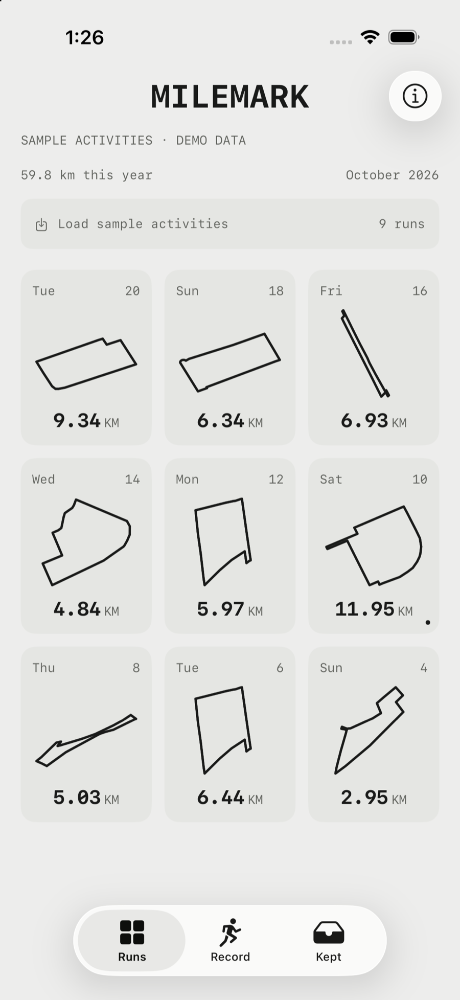
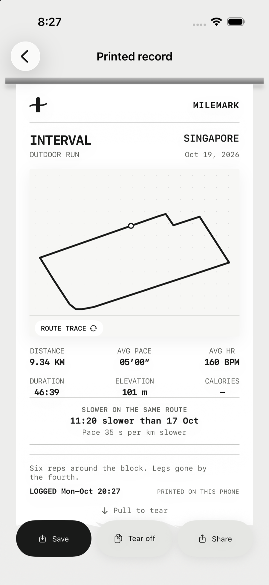
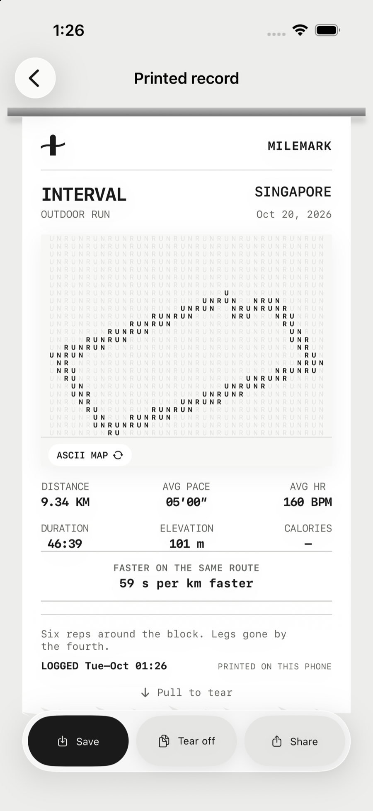
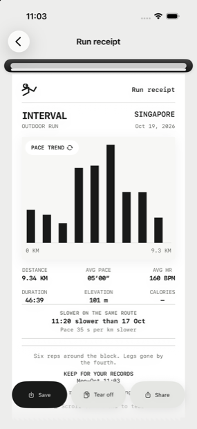
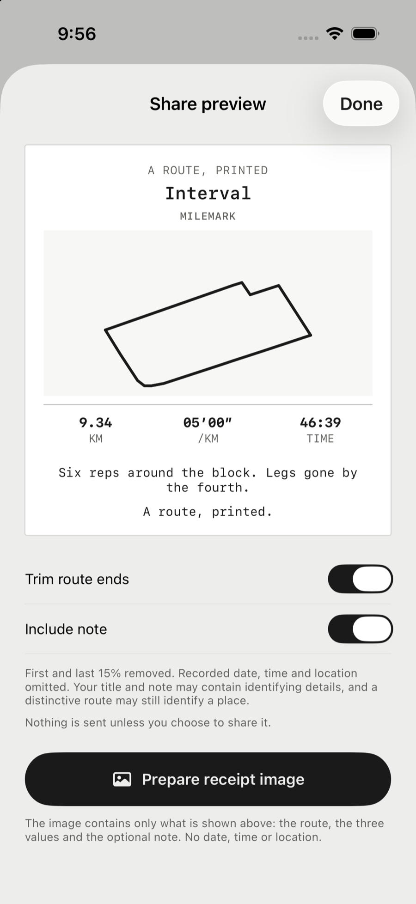
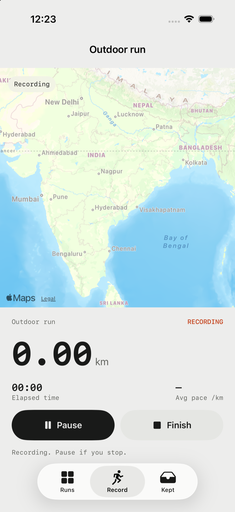

# Milemark

A running app for iPhone that turns every route into a printed receipt.

Milemark records a run on a real map, then prints it: a thermal-paper receipt
with your route drawn on it, your distance, pace and time, and an optional note.
Runs are kept in an archive of route silhouettes rather than a dashboard of
numbers, and finished receipts can be collected into a collection or shared
with the ends of the route trimmed.

## Screens

| | | |
|---|---|---|
|  |  |  |
| **Runs** — every route as its own shape | **The receipt** — printed from a slot | **ASCII** — the same route, printed |
|  |  |  |
| **Pace** — inspectable per kilometre | **Share** — with the route ends trimmed | **Recording** — a quiet map, a vivid track |

These are the real app running in the simulator, captured by
[`design/capture-screenshots.sh`](design/capture-screenshots.sh).

## Status

**Early development.** The core loop — record a run, review it, print the
receipt, keep it, share it — is implemented and runs on a simulator. Several
surfaces are still provisional.

| Area | State |
|---|---|
| Route recording with Core Location | Working, including pause/resume, auto-pause and background location |
| Live map | Working, with a quiet muted basemap and a vivid track |
| Route archive | Working |
| Printed receipt with four graphic treatments | Working |
| Review and share preview | Working |
| Sharing | Exports a receipt image to the system share sheet |
| Photo print treatment | Working, with a halftone treatment |
| Collection of kept receipts | Working |
| Comparison with the last run on the same route | Working |
| Strava import | Not implemented — the archive header is demo data |
| Health / heart rate | Not implemented — the receipt shows `—` |

## Requirements

- Xcode 27 or later
- iOS 18 or later
- A physical device to record a real run: the simulator has no location feed

## Building

The Xcode project is generated from `project.yml` with
[XcodeGen](https://github.com/yonaskolb/XcodeGen), so the project file is never
committed and there are no merge conflicts in it.

```sh
brew install xcodegen
xcodegen generate
open Milemark.xcodeproj
```

Then run the `Milemark` scheme, or from the command line:

```sh
xcodebuild -project Milemark.xcodeproj -scheme Milemark \
  -destination 'platform=iOS Simulator,name=iPhone 17 Pro' build
```

## Testing

```sh
xcodebuild -project Milemark.xcodeproj -scheme Milemark \
  -destination 'platform=iOS Simulator,name=iPhone 17 Pro' test
```

`RouteGeometryTests` covers the parts where a bug would quietly produce a
wrong number rather than a crash: distance accumulation, sample rejection,
splits, pace formatting, route normalisation and endpoint trimming.

`RunRecorderTests` covers the recorder's decisions: distance accumulation,
standing still, implausible jumps, pausing and the auto-pause threshold.

`MilemarkUITests` drives the app end to end — opening a receipt, changing
the graphic, pulling the paper short of the tear and past it, tearing off,
and opening the share preview. A screenshot cannot show whether a gesture
behaves.

## Sample activities

The archive can load nine sample activities so a receipt can be seen before
recording a run of your own. Their routes are **real street loops** — genuine
closed circuits in the OpenStreetMap data bundled in `design/assets`, found by
`design/make-demo-routes.swift`. They are not recordings of anyone's run, and
the archive header says the data is demo data.

Two launch arguments help when capturing screenshots or driving the UI:

```sh
# seed the samples and open the first receipt
xcrun simctl launch booted app.milemark.app -seedDemoData -openReceipt

# open the recording screen and start a run
xcrun simctl launch booted app.milemark.app -showRecord -startRecording
```

A location can be fed to the simulator while a run is recording:

```sh
xcrun simctl location booted set 1.3050,103.8700
```

## Continuous integration

GitHub Actions builds the app and runs the tests on every push and pull
request.

## The receipt

The paper comes out of a metal tray rail and stays in one place while the
graphic changes inside it. Four treatments are available: the route trace, an
ASCII map printed as a field of characters, a pace chart per kilometre, and a
photograph treated like a halftone print.

The tear is the interaction people describe. The grip at the end of the paper
says what to do: it only offers the pull once the receipt has been scrolled to
the end, because a pull in the middle of a long receipt is a scroll. The paper
then follows the finger, and released short of the threshold it springs back
into the slot. The **Tear off** button in the action bar does the same thing
without the gesture.

A receipt also compares itself with the last time the same route was run. The
comparison is made on the shape of the route rather than on its samples, so two
laps of the same loop match even when one of them has a lap more.

## The reference, and what is deliberately different

This app was inspired by a running app that prints a receipt for each run. The
inspiration was the idea — a run recorded as a physical printout — and the
motion of paper feeding out of a machine.

The receipt here is **not a copy of it**, and the differences are deliberate:

| | The reference | Here |
|---|---|---|
| Mark | A pair of running figures | A mile marker with a route running through it |
| Masthead | The product's own name | The MILEMARK wordmark |
| Footer | A centred stamp, a slogan and a fine-print line | A left-aligned `LOGGED …` with `PRINTED ON THIS PHONE` opposite it |
| Slogan | "You kept the streak going." | "A route, printed." |
| Paper edge | A regular zigzag perforation | A torn edge with shallow fibres |
| Where the paper comes from | A black slot | A metal tray rail |
| The picture | A badge top-left and a circular control bottom-right | A caption strip along the bottom edge |
| Statistics | Three across, one below | Six in a three-by-two grid |
| Extra | — | A comparison with the last run on the same route |

No artwork, name or copy is taken from the reference app. The ideas taken are
generic ones: a receipt is a document, and a document about a run can be
printed.

## Design

The visual direction is documented in [`design/`](design/):

- [`design/DIRECTION.md`](design/DIRECTION.md) — the brief, the reference
  contract, the content, the tokens and the motion rules.
- [`design/CRITIQUE.md`](design/CRITIQUE.md) — two independent design reviews,
  the fixes they asked for, and the warnings that were deliberately accepted.
- [`design/receipt-motion.prototype.html`](design/receipt-motion.prototype.html)
  — the clickable prototype the app was built from.
- [`design/PROTOTYPE.md`](design/PROTOTYPE.md) — how to open and exercise the
  prototype.

`MILEMARK` is a working title. It is not a settled brand, and it is not
trademark-checked.

## How recording works

Milemark records location with Core Location and draws the route with MapKit.
Neither costs money: Apple's native map display has no usage charge, and
recording a route does not need a routing or directions service.

The map is drawn with MapKit using a **muted** standard style — no points of
interest, no traffic, no rotation — so the recorded track and the runner are
the only saturated things on screen. The route is drawn by MapKit itself; a
SwiftUI filter applied to the map breaks its metal-rendered tiles.

The recorder is deliberately strict, because a plausible-looking route that is
wrong is worse than no route at all:

- Fixes older than ten seconds, or with an accuracy worse than 40 m, are
  discarded.
- A jump that would imply running faster than 12 m/s is discarded.
- Movement smaller than 40 cm between samples is treated as noise, so standing
  still does not add distance.
- Pausing stops the clock and the distance. Resuming starts a new segment, so
  the route never draws a false straight line across the gap, and the distance
  covered during the pause is never counted.
- If the runner stops for more than twelve seconds, the run pauses itself.
  The test is deliberately slow, so a pause at traffic lights is not mistaken
  for the end of the run.

None of this makes a route guaranteed accurate. It makes the app refuse to
invent distance when the signal is poor.

## Privacy

Runs are stored locally on the device. There is no account and no server.

The share preview leaves out the recorded date, time and location, and can trim
the first and last 15% of the route. That is not anonymity: a distinctive route,
a run title or a personal note can still identify a place or a person. The app
says so rather than implying a guarantee it cannot make.

## Licence

MIT. See [LICENSE](LICENSE).

Map data is drawn by MapKit at runtime. Any bundled or derived geographic data
in `design/` carries its own OpenStreetMap ODbL attribution.
