<div align="center">
  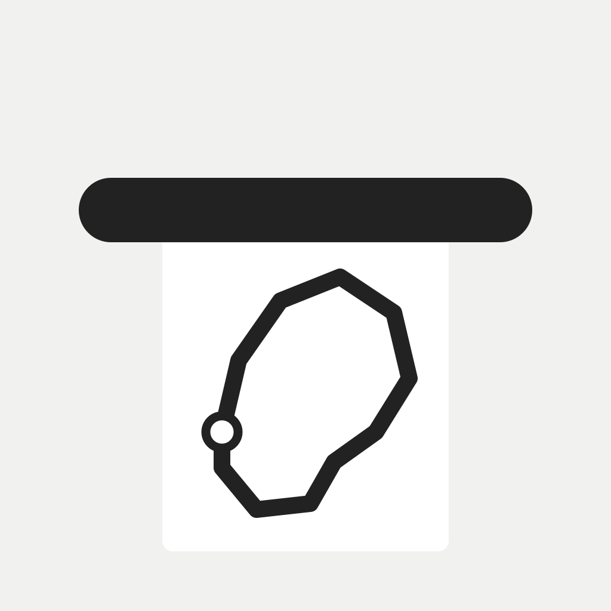

  <h1>Milemark</h1>

  <p><strong>A running app that prints your route as a receipt.</strong><br />
  Thermal paper, a drawn route, your distance and pace — and then you tear it off.</p>

  <p>
    <a href="#requirements"></a>
    <a href="#tech-stack"></a>
    <a href="#tech-stack"></a>
    <a href="#tech-stack"></a>
    <a href="#whats-built"></a>
    <a href="LICENSE"></a>
  </p>
</div>

> [!IMPORTANT]
> **Milemark is pre-release.** The core loop — record a run, review it, print the receipt, keep it, share it — is implemented and runs on a simulator. **Nothing has been tested on a physical device**, nothing is on the App Store, and `MILEMARK` is a working title rather than a settled brand.

## See it in use

<p align="center">
  <a href="design/demo/milemark-demo.mp4">
    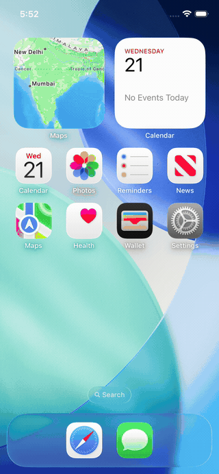
  </a>
</p>

<p align="center">
  <a href="design/demo/milemark-demo.mp4"><strong>Watch the 28-second demo</strong></a><br />
  <sub>One continuous take · Normal speed · MP4 under 200 KB</sub>
</p>

Open a run, watch the receipt feed out of the tray, then pull the paper off. The
grip at the bottom of the sheet only offers the pull once the receipt has been
scrolled to the end, because a pull in the middle of a long receipt is a
scroll.

Every screenshot below is a real capture from the **iPhone 17e simulator on
iOS 26.5**. The device — its metal edge, its black bezel, its Dynamic
Island — is drawn around the capture; the app pixels inside it are
untouched. See [the note on verification](#known-limits).

## Why Milemark?

Most running apps are dashboards: a map, a number, a ring that fills, a chart
that trends. Milemark makes an **object** instead. A run becomes a receipt —
something you look at, keep, and hand over.

- **The receipt is the product.** A run is not a set of metrics to be
  refreshed. It is a printed thing with a shape, a number, a date and your
  handwriting on it. The route is drawn as a line, not as a polyline on a
  basemap.
- **The archive is a set of shapes.** Every run is one silhouette on a card.
  You recognise the run by its outline the way you recognise a handwriting
  sample, not by reading a distance off a list.
- **The tear is the interaction.** The paper follows your finger and comes
  away. Every other running app's primary gesture is a button.
- **No account, no server, no feed.** Runs live in a JSON file on the phone.
  There is nothing to sign up for and nothing to upload. The only thing this
  app talks to is Apple, and — if you ask it to — Strava.
- **Quiet by default.** The basemap is held back to a whisper, the route is
  the only saturated thing on screen, and there are no points of interest on
  the map. A pin for a bubble tea shop is not a run.

## Screens

<p align="center">
  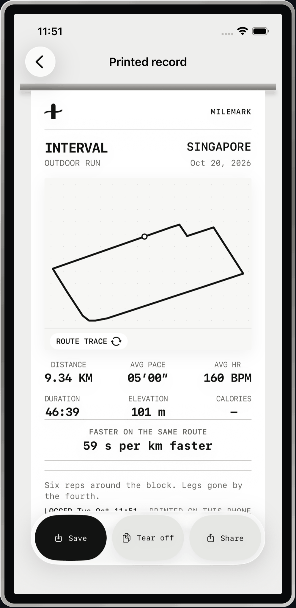
  <br />
  <sub><strong>The receipt</strong> — the paper comes out of a metal tray, the route is drawn on it, and the numbers are set in a monospaced face beneath.</sub>
</p>

<table>
  <tr>
    <td width="50%">
      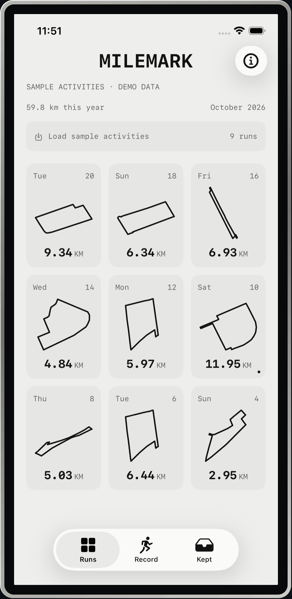
      <br /><sub><strong>Archive</strong> — every route as its own shape, with its date and distance.</sub>
    </td>
    <td width="50%">
      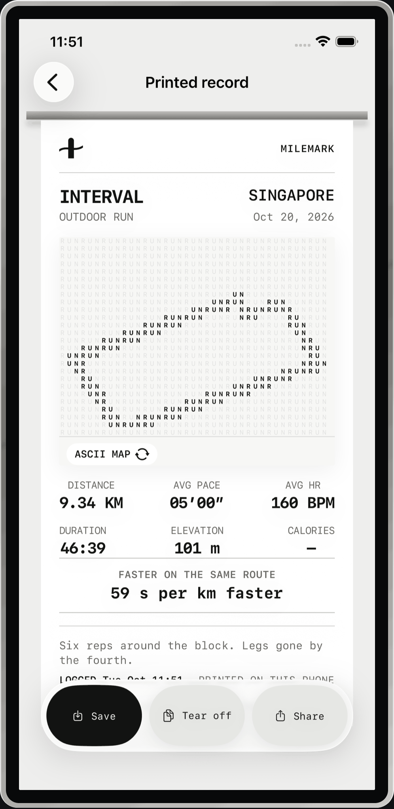
      <br /><sub><strong>ASCII</strong> — the same route, printed row by row as a field of characters.</sub>
    </td>
  </tr>
  <tr>
    <td width="50%">
      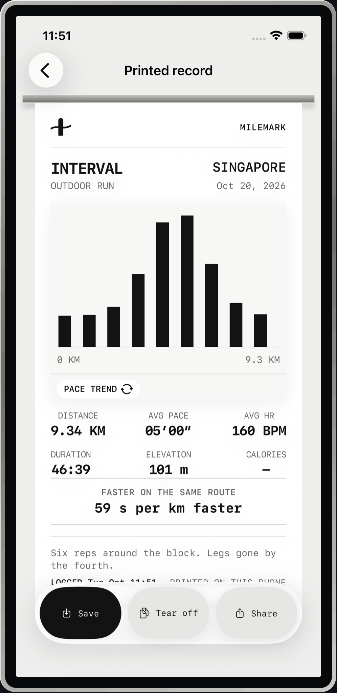
      <br /><sub><strong>Pace</strong> — a chart per kilometre that you can scrub, with the fastest one marked.</sub>
    </td>
    <td width="50%">
      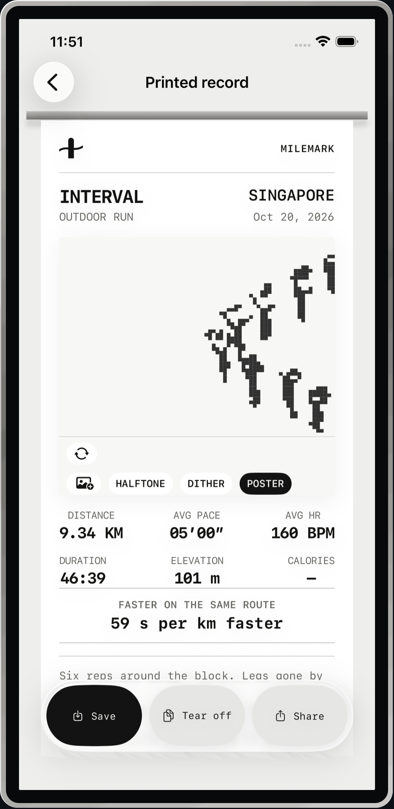
      <br /><sub><strong>Photo</strong> — a photograph printed three ways: halftone, ordered dither, poster.</sub>
    </td>
  </tr>
  <tr>
    <td width="50%">
      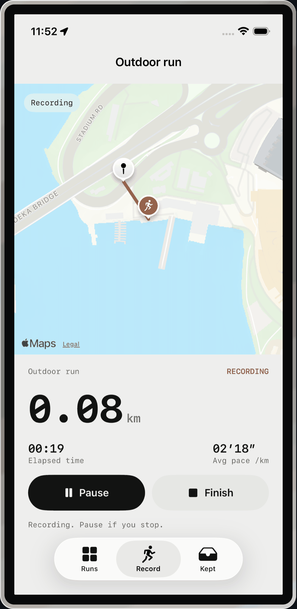
      <br /><sub><strong>Recording</strong> — a quiet map, a vivid track, and the paper that will come out of it.</sub>
    </td>
    <td width="50%">
      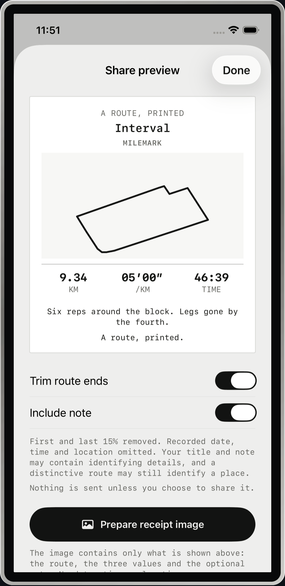
      <br /><sub><strong>Share</strong> — the image that leaves the phone, with the route's ends trimmed.</sub>
    </td>
  </tr>
  <tr>
    <td width="50%">
      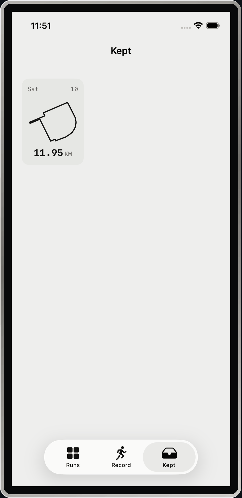
      <br /><sub><strong>Kept</strong> — the receipts you decided to keep.</sub>
    </td>
    <td width="50%">
      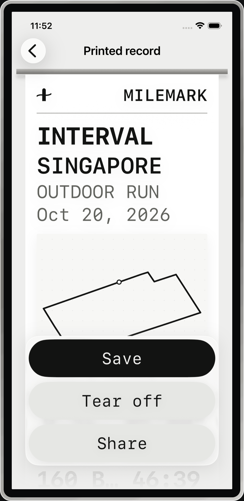
      <br /><sub><strong>Large text</strong> — the same receipt at <code>accessibility3</code>. The layout gives way rather than the type shrinking back down.</sub>
    </td>
  </tr>
</table>

<p align="center">
  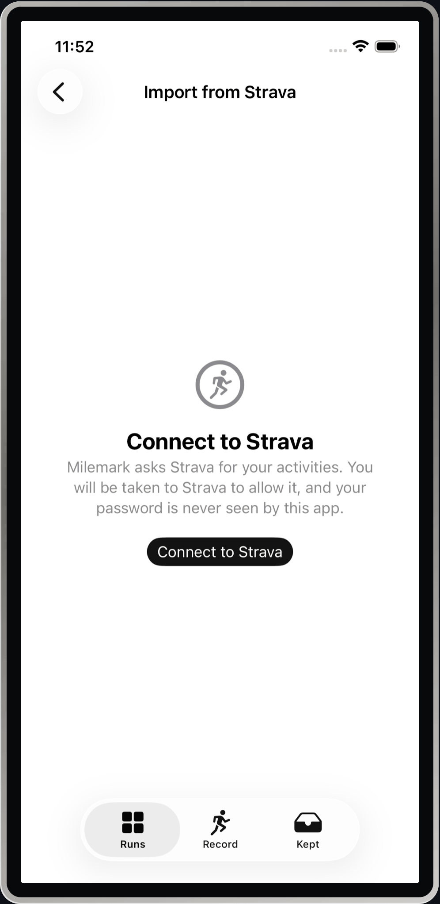
  <br />
  <sub><strong>Import</strong> — bring in runs recorded by another app. The browser does not open on its own; the app asks first.</sub>
</p>

## What's built

The full local-first loop is implemented and covered by 62 unit tests and 8 UI tests:

- **Recording** — Core Location, with pause and resume, an auto-pause after
  twelve seconds of stillness, segment breaks that leave a real gap in the
  track, and a clock worked out from the dates so a run keeps recording with
  the phone locked
- **Live map** — MapKit with a flat, muted basemap, no points of interest and
  no traffic; the route is inked over it with a casing, the way a road is
  printed, and the marks on it are drawn by the app rather than by the system
- **Archive** — every run as its own route silhouette, with its date and
  distance, and a card that becomes one across at the larger text sizes
- **Receipt** — four treatments on the same paper: the route trace, an ASCII
  map, a per-kilometre pace chart you can scrub, and a photograph printed
  three ways
- **Tear** — the paper follows the finger, springs back if the pull is short
  of the threshold, and comes away if it is not; a button does the same thing
  without the gesture
- **Review** — name the run and add a note before it is printed
- **Collection** — keep the receipts you want; the collection is in the app
  and nowhere else
- **Comparison** — the pace against the last run on the same route, matched on
  shape, distance and where it started
- **Share** — a PNG with the route's first and last 15% trimmed, the date,
  time and location left out, and copy that says plainly that this is not
  anonymity
- **Text size** — Dynamic Type from the smallest size to the largest, with the
  layouts reflowing rather than the type shrinking back down
- **Import from Health** — reads the workouts the system already holds, and
  their heart rate
- **Import from Strava** — OAuth in a system sheet, token refresh, and your
  activities, decoded from their polylines
- **Motion** — the paper feeds out of the tray with a contact shadow and a run
  of soft print ticks; the route grows into the receipt; reduce motion removes
  the travel and keeps everything else
- **Haptics** — a selection tick when a treatment changes, a landing when the
  paper comes away, a run of transients while it prints
- **Liquid Glass** — the action bar on the real system material on iOS 26 and
  later, and a matched flat bar where it does not exist

**Not built yet:**

- [ ] Physical-device testing: haptics, background recording with the screen
  locked, real GPS, battery
- [ ] App Store release: listing, privacy nutrition labels, TestFlight
- [ ] A custom map style in the Strava sense — that needs a vector tile
  server, and this app has no server
- [ ] A name. `MILEMARK` is a working title and has not been trademark-checked
- [ ] HealthKit on a device with a real workout in it
- [ ] Strava against live credentials

**Known limits:** verification so far covers the **iPhone 17e simulator on
iOS 26.5** — 62 unit tests and 8 UI tests, all green on CI. Physical-device
haptics, background recording on a locked device, real GPS accuracy, the
HealthKit permission flow on a device, and the Strava authorisation sheet are
**unverified**; the last one does not present in this simulator at all. The
`ASWebAuthenticationSession` sheet could not be captured, and the Strava
import has never run against live Strava credentials, because the keys are
deliberately not in the repository. The app's own text follows Dynamic Type
from the smallest size to the largest, but the **shared card** — the image
that leaves the phone — keeps a fixed composition on purpose, because it is
exported to a fixed canvas.

## Tech stack

| Layer | Technology |
|---|---|
| Platform | iOS 18+ (iPhone and iPad) · iOS 26 features are used where they exist |
| Language | Swift 6, strict concurrency |
| UI | SwiftUI |
| Maps | MapKit — `MKMapView` with `MKStandardMapConfiguration`, and a custom overlay renderer for the route |
| Location | Core Location, with the Always permission for background recording |
| Health | HealthKit — read only, never write |
| Web | AuthenticationServices for the Strava sign-in sheet; the token is kept in the keychain |
| Storage | JSON in Application Support, plus `UserDefaults` for settings |
| Tests | XCTest — 62 unit tests, 8 UI tests |
| Project | XcodeGen — `project.yml` is the source; the `.xcodeproj` is never committed |
| CI | GitHub Actions on `macos-15` |

## Project structure

```
Milemark/
├── App/
│   ├── Sources/
│   │   ├── App/                 # MilemarkApp, RootView, launch arguments
│   │   ├── Core/
│   │   │   ├── Design/          # Theme, MapStyle, LiquidGlass, Motion
│   │   │   ├── Models/          # Run, RoutePoint
│   │   │   └── Services/        # RunRecorder, RunStore, RouteGeometry, Strava, HealthKit
│   │   └── Features/            # Archive, Tracking, Review, Receipt, Share, Collection, Import
│   ├── Tests/                   # 62 unit tests
│   ├── UITests/                 # 8 UI tests
│   └── Resources/               # Info.plist, entitlements, privacy manifest, assets
├── Screenshots/
│   └── frames/                  # The framed images used in this readme
├── design/
│   ├── map-style/               # The figure that explains what a map style is
│   ├── demo/                    # The demo GIF and its MP4
│   ├── assets/                  # OpenStreetMap extracts for the sample routes
│   ├── DIRECTION.md             # The brief, the reference contract, the tokens
│   ├── CRITIQUE.md              # Two independent design reviews, and what they found
│   └── ATTRIBUTION.md           # OSM ODbL, and the Unsplash sample photo
├── project.yml                   # The Xcode project, in XcodeGen form
└── .github/workflows/ci.yml      # Build, test, and a readme check
```

## Getting started

**Requirements:** Xcode 27 or later, and macOS with the iOS 26.5 simulator
runtime. A physical iPhone is needed to record a real run, because the
simulator has no location feed.

```bash
git clone git@github.com:PratikRai0101/Milemark.git
cd Milemark
brew install xcodegen
xcodegen generate
open Milemark.xcodeproj
```

Then run the `Milemark` scheme. From the command line:

```bash
xcodebuild -project Milemark.xcodeproj -scheme Milemark \
  -destination 'platform=iOS Simulator,name=iPhone 17e' test
```

### Running it on your own iPhone

Free Apple account: Xcode signs the app to your device, but the provisioning
profile expires after seven days and you re-sign about once a week. A paid
**Apple Developer Program** membership ($99/year) gives you a year of
profiles, the App Store, and — because the capability is not available on a
free account — **HealthKit**.

### The import services

Both are optional. The app works without either, and says so plainly when it
cannot use them.

| | What it needs | What it costs |
|---|---|---|
| **Health** | The HealthKit capability on your app's identifier, and a provisioning profile that includes it | Free, but it needs the $99 Apple Developer Program |
| **Strava** | A client ID and secret from [strava.com/settings/api](https://www.strava.com/settings/api), with the redirect URI registered as `milemark://strava/callback` | A Strava subscription — $11.99/month or $79.99/year — which is now a prerequisite for creating an API application. No extra API fee on top of it |

The Strava keys are build settings, not values in the repository:

```sh
STRAVA_CLIENT_ID = "your client id"
STRAVA_CLIENT_SECRET = "your client secret"
```

The redirect URI registered with Strava must be `milemark://strava/callback`
exactly, which is what the app asks for.

### What it costs to run

**Nothing, and it stays that way.** The app is MIT-licensed, has no server and
no backend, and makes no paid API calls. MapKit in a native app is free
beyond your Apple membership. Every run stays on the phone. If you publish
it, the people who install it pay nothing either.

### Quality gates

```bash
python3 design/check-readme.py   # every image and link in this file resolves
xcodebuild test -project Milemark.xcodeproj -scheme Milemark \
  -destination 'platform=iOS Simulator,name=iPhone 17e' test
```

### Regenerating the screenshots

```bash
bash design/capture-screenshots.sh "iPhone 17e"   # raw captures into .captures/
node design/render-frames.mjs                    # framed images into Screenshots/frames/
```

The frames are a thin bezel drawn tight to the screen, with no caption in
the image — the readme writes the caption underneath it. They are then
shrunk to a 128-colour palette, which is indistinguishable on a page of
greys and one third of the size.

The capture script **fails** if the recorded track is not in the frame, so a
blank map can never be published as a capture of a working screen.

## Documentation

| Document | What it covers |
|---|---|
| [design/DIRECTION.md](design/DIRECTION.md) | The brief, the reference contract, the content, the tokens and the motion rules |
| [design/CRITIQUE.md](design/CRITIQUE.md) | Two independent design reviews, what they found, and what was done about it |
| [design/map-style/](design/map-style/) | The figure that explains what a map style is, and why the basemap's ink and the route's ink are separate |
| [design/ATTRIBUTION.md](design/ATTRIBUTION.md) | OpenStreetMap ODbL, and the Unsplash sample photograph |
| [design/PROTOTYPE.md](design/PROTOTYPE.md) | The browser prototype this app was built from, and the two reviews that shaped it |

## License

[MIT](LICENSE) © Pratik Rai
